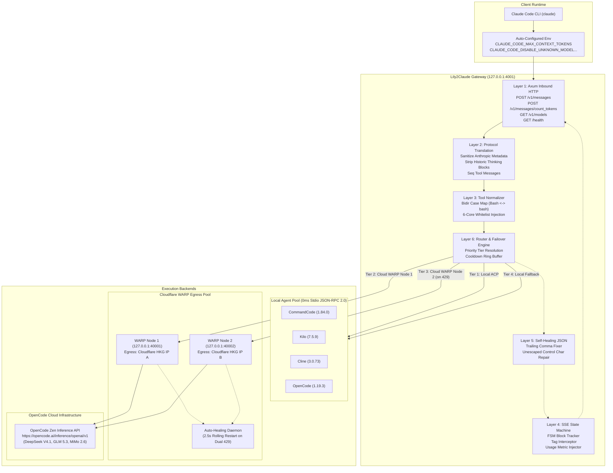

# Lily2Claude: Production Architecture & DevOps Engineering Specification

> **Mission:** Transform Claude Code CLI into an ultra-fast, resilient, multi-agent orchestrator backed by zero-cost cloud models (OpenCode Zen Free Tier via Cloudflare WARP) and zero-latency local agents (CommandCode, Kilo, Cline via ACP stdio), with enterprise-grade DevOps reliability, transparent aliases, and zero network probing.

---

## 1. System Topology & Flow Architecture



---

## 2. Comprehensive Layer-by-Layer Architectural Specification

### Layer 1: Inbound HTTP & Endpoint Lifecycle (Claude Code Facing)
- **Framework:** Axum 0.7 + Hyper with Tokio multi-threaded runtime.
- **Endpoints:**
  1. `POST /v1/messages`:
     - **Streaming Branch (`stream: true`):** Emits Anthropic Server-Sent Events (`text/event-stream`) via bounded channel (`tokio::sync::mpsc::channel(128)`).
     - **Non-Streaming Branch (`stream: false`):** Aggregates upstream completion chunks and returns a canonical Anthropic `Message` JSON object. **Essential for Claude Code background session title generation.**
  2. `POST /v1/messages/count_tokens`:
     - Computes token usage based on BPE estimation / character ratio in <1ms. Required by Claude Code UI and compaction triggers.
  3. `GET /v1/models`:
     - Exposes transparent aliases (`deepseek`, `glm`, `kilo`, `luna`, `mimo`, `nemotron`) and catalog models without masking behind `opus`/`sonnet`.
  4. `GET /health` & `GET /api/status`:
     - Returns live WARP node IPs, cooldown status, active local ACP worker counts, and memory metrics.

### Layer 2: Protocol Translation & Message Normalization (Anthropic <-> OpenAI)
- **System Prompt Fusion:**
  - Anthropic allows top-level `system` (string or array of text blocks) as well as `role: "system"` messages in `messages`.
  - Normalizer concatenates all system directives into a single `role: "system"` message at index 0.
- **Anthropic Metadata Sanitization:**
  - Strips proprietary Anthropic fields: `cache_control: {"type": "ephemeral"}`, `context_management`, `output_config`, `thinking: {"type": "adaptive"}`.
  - Prevents upstream `400 Bad Request: Additional properties not allowed` errors on strict vLLM/OpenAI backends.
- **Historic Thinking Block Suppression:**
  - Claude Code turn 2+ sends prior assistant messages containing `[{"type": "thinking", ...}, {"type": "text", ...}]`.
  - Upstream OpenAI schemas reject structured thinking blocks in `content`.
  - Normalizer extracts text and tool calls while cleanly stripping historic thinking blocks.
- **Tool Result De-bundling:**
  - Claude Code bundles multiple `tool_result` blocks into a single `role: "user"` message.
  - Normalizer transforms each `tool_result` into an individual message with `role: "tool"`, `tool_call_id`, and `content`, positioned strictly after the assistant message declaring the corresponding `tool_calls`.
  - Any remaining user text is preserved in a trailing `role: "user"` message.

### Layer 3: Tool Whitelist & Bidirectional Case Normalization
- **Case Discrepancy Invariant:**
  - Claude Code: PascalCase (`Bash`, `Edit`, `Read`, `Write`, `Glob`, `Grep`).
  - OpenCode FreeTier: Strict lowercase (`bash`, `edit`, `read`, `write`, `glob`, `grep`).
- **Core Tool Whitelist Enforcement:**
  - OpenCode FreeTier server returns `403 FreeTierError` if any of the 6 core tools (`bash`, `edit`, `glob`, `grep`, `read`, `write`) are missing.
  - When routing to OpenCode, the normalizer checks the tool array and injects lightweight schemas for any missing core tools (e.g., `glob`, `grep` in Claude Code 2.1).
- **Bidirectional Mapping:**
  - **Outbound (to Upstream):** Names mapped to lowercase (`Bash` -> `bash`).
  - **Inbound (to Claude Code SSE):** Upstream tool responses mapped back to Claude Code's declared casing (`bash` -> `Bash`), preventing *"Unknown tool"* errors in the TUI.

### Layer 4: Outbound Streaming & SSE State Machine (OpenAI -> Anthropic)
- **FSM Block State Tracker:**
  - States: `Idle` -> `Thinking` -> `Text` -> `ToolUse` -> `Completed`.
  - Manages sequential `block_index` transitions and emits strict closing `content_block_stop` events before transitioning to a new block type.
- **Reasoning Content Dual Extraction:**
  - **Path A:** Standard `choices[0].delta.reasoning_content` (DeepSeek-V3, GLM).
  - **Path B:** Inline `<think>...</think>` tags in `choices[0].delta.content`. When `<think>` is encountered, the state machine diverts chunks into `thinking_delta`. Upon `</think>`, it cleanly transitions to `text_delta`.
- **Usage & Stop Reason Synchronization:**
  - Reads upstream `finish_reason`:
    - `"tool_calls"` -> Anthropic `stop_reason: "tool_use"`.
    - `"stop"` -> Anthropic `stop_reason: "end_turn"`.
    - `"length"` -> Anthropic `stop_reason: "max_tokens"`.
  - Transmits input/output token counts in `message_delta` so Claude Code's cost/token display updates accurately.

### Layer 5: Self-Healing JSON & Argument Repair Engine
- **Vulnerabilities in Open LLM Tool Calls:**
  - Unescaped newlines/tabs inside file content strings (common during large `Write` or `Edit` calls).
  - Trailing commas before closing braces: `{"path": "file.txt",}`.
  - Abrupt token truncation leaving unbalanced brackets/braces.
- **Repair Mechanics:**
  - In-place string scanner escapes unescaped ASCII control characters (`0x00` - `0x1F`) within double quotes.
  - Removes trailing commas preceding `}` or `]`.
  - Automatically balances unclosed braces when valid JSON prefix can be salvaged.

### Layer 6: Intelligent Router & Multi-Agent Failover Matrix
- **Priority Resolution:**
  1. **Tier 1 (Local ACP - 0ms Latency):** CommandCode / Kilo / Cline local processes.
  2. **Tier 2 (OpenCode Cloud WARP Node 1 - Port 40001):** FreeTier cloud models via first Cloudflare exit IP.
  3. **Tier 3 (OpenCode Cloud WARP Node 2 - Port 40002):** Immediate rotation upon HTTP 429.
  4. **Tier 4 (Local Agent Fallback):** Engaged if entire Cloud pool is cooling down or offline.
- **Zero-Scan In-Memory Discovery:**
  - Reads local JSON caches at startup in <15ms:
    - `/home/light/.cache/kilo/models.json` (131 free models with context limits).
    - `/home/light/.commandcode/cache/model-catalog/v1/*.json` (101 models).
  - Applies regex `r"(?i)(-free|:free|/free)$"` in-memory. Zero active network pings required.

### Layer 7: Cloudflare WARP Pool & Auto-Healing Egress
- **Topology:** Two isolated Docker containers (`test-warp-1` on 40001, `test-warp-2` on 40002) running `sing-box` WireGuard clients.
- **Independent Routing:** Each node maintains a separate WireGuard session with unique Cloudflare HKG egress IPs (`104.28.222.75` and `104.28.222.73`).
- **Auto-Healing on Dual Exhaustion:**
  - If both Node 1 and Node 2 encounter HTTP 429 simultaneously:
  - `lily2claude` triggers a non-blocking background task: `docker restart test-warp-1`.
  - Empirically verified: Restart completes in **2.5 seconds** and provisions a fresh Cloudflare egress IP, resolving rate limits without manual intervention.

### Layer 8: Local Agent ACP v1 Transport & Worker Pooling
- **Protocol:** Agent Client Protocol (ACP) v1 JSON-RPC 2.0 NDJSON over stdio.
- **Standard Handshake:**
  - `initialize`: `{"protocolVersion": 1, "clientInfo": {"name": "lily2claude", "version": "0.1.0"}, "capabilities": {}}`.
  - `session/new`: `{"cwd": "<project_dir>", "mcpServers": []}`.
- **Worker Management & Deadlock Prevention:**
  - Child processes spawned with piped `stdin`, `stdout`, and `stderr`.
  - **Deadlock Safeguard:** Asynchronously drains both `stdout` and `stderr` concurrently using `tokio::io::BufReader`. Unconsumed `stderr` buffers will never hang child processes.
  - **Session Affinity:** Correlates Claude Code's persistent `session_id` (from `metadata.user_id.session_id`) to warm child processes, eliminating repeated 500ms Node.js cold starts.

### Layer 9: Dynamic Context Limits & Environment Automation
- **Detection:** Metadata parser extracts exact context lengths (`context_length`) and max output tokens from catalog data.
- **Launcher Automation (`lily2claude launch --model <alias>`):**
  - Sets `CLAUDE_CODE_MAX_CONTEXT_TOKENS=<exact_limit>`:
    - `deepseek`: 200,000 (OpenCode) / 1,000,000 (CommandCode).
    - `kilo`: 256,000.
    - `luna`: 400,000.
    - `nemotron`: 1,000,000.
  - Triggers Claude Code's internal `/compact` prompt at ~80% window automatically.
  - Sets `CLAUDE_CODE_DISABLE_UNKNOWN_MODEL_WINDOW_ENFORCEMENT=1` to silence CLI nag warnings.
  - Sets upstream client timeout to **180 seconds** to accommodate large compaction prefill.

### Layer 10: Experimental Hallucinated Command Converter (Opt-in)
- **Design Rule:** Completely decoupled from the standard streaming hot-path.
- **No Synchronous Retry Loops:** Eliminates the 30-second freezes and retry loops of legacy implementations.
- **Post-Stream Terminal Inspection:**
  - If enabled via config (`[experimental.convert_hallucinated_commands = true]`):
  - When the model stream ends with `finish_reason: "stop"` without issuing tool calls, but the text consists entirely of a single executable code block (` ```bash\n<cmd>\n``` `):
  - Emits an Anthropic `tool_use: Bash` event for Claude Code to execute directly. Otherwise leaves text unmodified.

---

## 3. DevOps & Infrastructure Specifications

### 3.1 Docker Compose Deployment (`docker-compose.yml`)

```yaml
version: '3.8'

services:
  warp-1:
    image: ghcr.io/mon-ius/docker-warp-socks:latest
    container_name: lily-warp-1
    restart: always
    ports:
      - "127.0.0.1:40001:9091"
    volumes:
      - lily-warp-1-config:/etc/sing-box
    environment:
      - WARP_LICENSE=
    healthcheck:
      test: ["CMD", "curl", "-s", "-x", "socks5h://127.0.0.1:9091", "https://1.1.1.1/cdn-cgi/trace"]
      interval: 30s
      timeout: 5s
      retries: 3

  warp-2:
    image: ghcr.io/mon-ius/docker-warp-socks:latest
    container_name: lily-warp-2
    restart: always
    ports:
      - "127.0.0.1:40002:9091"
    volumes:
      - lily-warp-2-config:/etc/sing-box
    environment:
      - WARP_LICENSE=
    healthcheck:
      test: ["CMD", "curl", "-s", "-x", "socks5h://127.0.0.1:9091", "https://1.1.1.1/cdn-cgi/trace"]
      interval: 30s
      timeout: 5s
      retries: 3

volumes:
  lily-warp-1-config:
  lily-warp-2-config:
```

### 3.2 Linux Systemd User Service (`~/.config/systemd/user/lily2claude.service`)

```ini
[Unit]
Description=Lily2Claude Universal AI Bridge Daemon
After=network.target docker.service

[Service]
Type=simple
ExecStart=/home/light/.cargo/bin/lily2claude serve --port 4001 --host 127.0.0.1
Restart=on-failure
RestartSec=5s
Environment=RUST_LOG=info,lily2claude=debug
LimitNOFILE=65536

[Install]
WantedBy=default.target
```

### 3.3 Zero-Copy High-Performance Tokio Runtime Settings
- **Async Engine:** Tokio with `epoll` on Linux.
- **Buffer Allocation:** Reusable `bytes::BytesMut` chunk buffers for zero-copy stream forwarding.
- **TCP Socket Tuning:** `TCP_NODELAY` enabled on incoming Claude Code and outgoing upstream sockets to minimize packet framing latency.
- **Process Supervision:** Unix signal handling for `SIGINT` / `SIGTERM` with clean shutdown cascade ensuring all spawned ACP worker subprocesses are cleanly killed before exit.

---

## 4. Test & Verification Matrix

| Verification Vector | Target | Acceptance Criteria |
| :--- | :--- | :--- |
| **WARP Egress Diversity** | Ports 40001 & 40002 | Both return distinct Cloudflare HKG IPs; zero port collision. |
| **OpenCode Free Bypass** | Inference endpoint | Passes 6-tool check + session header; HTTP 200 with reasoning tokens. |
| **ACP v1 Protocol Handshake** | `commandcode`, `kilo`, `cline`, `opencode` | All 4 agents return `protocolVersion: 1` and spawn session with `mcpServers: []`. |
| **Claude Code Direct Run** | `claude --model deepseek` | Claude Code accepts custom alias; executes 2-turn bash tool with collapsible thinking. |
| **Token Counter Endpoint** | `POST /v1/messages/count_tokens` | Returns integer token count in <1ms without 404. |
| **Session Title Generation** | `POST /v1/messages` (`stream: false`) | Returns single Anthropic Message JSON payload with session title. |
| **Rate Limit Failover** | Simulated 429 on WARP Node 1 | Instantly retries Node 2; overall request latency < 150ms delta. |
| **Dual 429 Auto-Heal** | Both nodes 429 | Container restart initiates; fresh Cloudflare IP provisioned in < 3s. |
