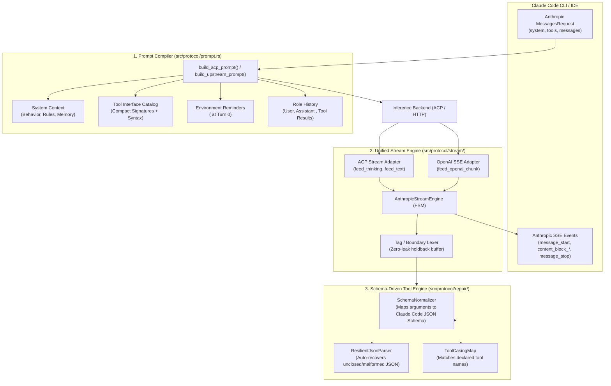
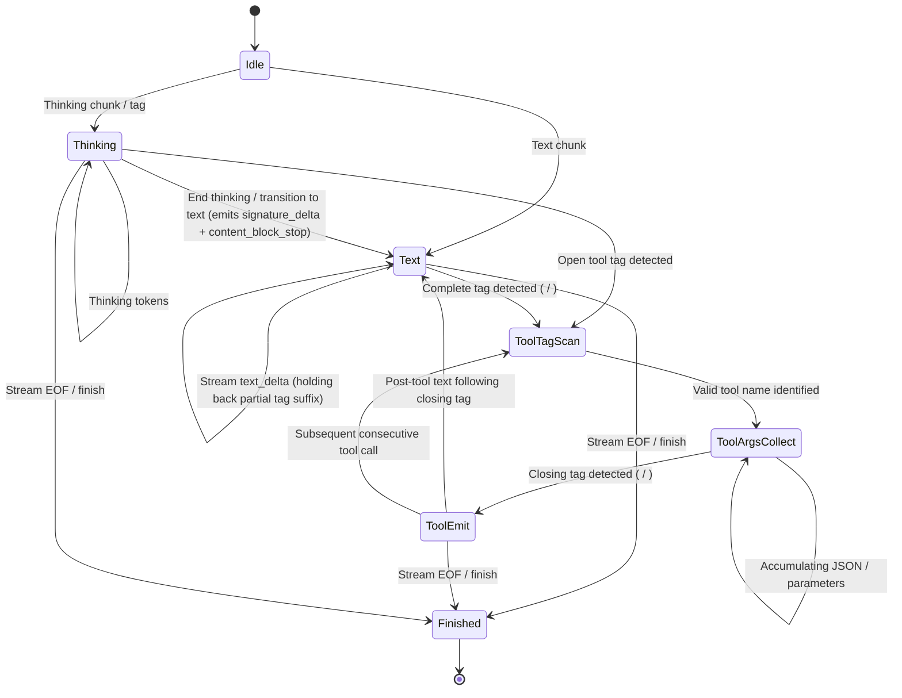

# Architecture Design: Unified State Machine & Schema-Driven Engine for Lily2Claude

- **Author:** Antigravity Engineering & User Pair Programming
- **Date:** 2026-10-20
- **Status:** Proposed
- **Target Version:** lily2claude v0.2.0

---

## 1. Executive Summary & Problem Statement

### 1.1 Background
`lily2claude` acts as an Anthropic-compatible API bridge for Claude Code CLI and IDE extensions. It enables local and external LLMs (e.g. DeepSeek V4.1, GLM 5.3, Nemotron 3 Ultra) accessed via ACP (OpenCode, CommandCode) or OpenAI-compatible HTTP endpoints to power Claude Code.

### 1.2 Core Issues in Current Architecture
1. **Double System Prompt Wrapping & Semantic Conflict:**
   OpenCode ACP wraps its own system prompt ("You are OpenCode... Meta MSL") with Code Mode JS tools (`execute`, `search`), conflicting with Claude Code's system prompt and tool definitions.
2. **Fragmented Heuristic Parsing ("Parse linh tinh"):**
   The current repair layer (`src/protocol/repair/`) consists of 6 ad-hoc modules (`casing.rs`, `cleaner.rs`, `extractor.rs`, `json_args.rs`, `normalization.rs`, `validation.rs`) using disconnected regexes and heuristics.
3. **Divergent Streaming Implementations:**
   `AnthropicBlockStreamer` (for ACP output) and `SseStreamTranslator` (for OpenAI HTTP chunks) maintain separate, duplicate state machines with divergent bug fixes and token pacing logic.
4. **Context Ledger Token Inaccuracy:**
   Streaming delta events previously duplicated `input_tokens`, causing Claude Code's `/context` display to show inflated token counts (e.g. 577.1k/160k tokens).

### 1.3 Design Goal
Re-architect `lily2claude` into a **Unified, Cohesive Architecture** ("một thể thống nhất") modeled after Claude Code's native architecture:
- Cleanly compile prompts following Claude Code's separation of concerns (System Context vs Tool Interface vs Environment Reminders vs Turn Dialogue).
- Unify streaming and parsing into a single **Deterministic Finite State Machine (FSM)**.
- Replace ad-hoc heuristic regexes with a **Schema-Driven Normalizer** that validates arguments directly against Claude Code's declared tool schemas.

---

## 2. Architecture Overview



---

## 3. Detailed Component Specifications

### 3.1 Prompt Compiler (`src/protocol/prompt.rs`)
The prompt compiler transforms an Anthropic `MessagesRequest` into an upstream prompt that maximizes instruction adherence while minimizing token usage.

#### Structure & Ordering:
1. **System Context:**
   - Preserves Claude Code's native developer instructions (`# System`, `# Doing tasks`, `# Executing actions with care`, `# Tone and style`, `# auto memory`).
   - Excludes raw JSON Schema dumps from the system string to conserve context window.
2. **Tool Interface Catalog (omitted during compaction):**
   - Declares tools using compact, clear parameter signatures:
     ```text
     [Tools Instruction]
     To invoke a tool, output:
     <tool_call>
     {"name": "<tool_name>", "arguments": {<args>}}
     </tool_call>

     Available tools:
     - Bash(command, run_in_background?, timeout?)
     - Edit(file_path, new_string, old_string, replace_all?)
     - Read(file_path, limit?, offset?)
     - Write(content, file_path)
     - Agent(description, prompt, subagent_type?)
     ...
     ```
   - Appends an authoritative directive:
     `All tools are executed directly by the Claude Code harness. Never inspect local function catalogs.`
3. **Environment & Context Reminders:**
   - Preserves `<system-reminder>` blocks (working directory, platform, shell, OS, git status) within user turns, matching Claude Code's native turn structure.
4. **Dialogue Turns:**
   - Formats `User:`, `Assistant:`, and `Tool Result:` cleanly.
   - Serializes previous assistant tool calls as `<tool_call>` and tool results as `<tool_result>` (with `error=true` if applicable).
5. **Compaction Mode:**
   - When `req.is_compaction_request()` is true:
     - Strips tool declarations completely.
     - Injects `[COMPACTION DIRECTIVE]` requesting only `<summary>...</summary>`.

---

### 3.2 Unified Stream Engine (`src/protocol/stream/`)
Merges `block_streamer.rs` and `translator.rs` into a single `AnthropicStreamEngine` that governs the SSE lifecycle for both ACP and OpenAI HTTP backends.

#### Finite State Machine (FSM) States:


#### Key Invariants:
1. **Holdback Buffer for Boundary Safety:**
   - Any trailing prefix matching `<tool_call`, `</tool_call`, `<invoke`, `</invoke`, `<think`, or `</think` is held back in the buffer until the next chunk resolves the tag.
   - Prevents tag leakage into user-visible chat text.
2. **Smooth Text Pacing:**
   - Streams visible text in bounded chunks (256 bytes) to deliver smooth terminal UI rendering without stalls.
3. **Interleaved Text and Tool Calls:**
   - When a model outputs `text -> tool_call -> text`, the engine closes the text block, opens the `tool_use` block, closes it, and re-opens a new text block for trailing text without truncating explanations or follow-up questions.
4. **Accurate Token Reporting:**
   - Emits `input_tokens` and `cache_read_input_tokens` **only once** in `message_start`.
   - Subsequent `message_delta` events contain only output token counts, preventing `/context` inflation.

---

### 3.3 Schema-Driven Tool Normalizer & Resilient Parser (`src/protocol/repair/`)
Consolidates the 6 scattered modules into a clean, 3-tier tool processing engine:

1. **Tag Lexer (`repair/tag_lexer.rs`):**
   - Formal scanner that extracts `<tool_call>...</tool_call>` (primary) and `<invoke name="...">...</invoke>` (fallback).
   - Replaces fragmented regex hunting with character-index scanning.
2. **Resilient JSON Parser (`repair/json_parser.rs`):**
   - Parses arguments JSON with automatic recovery for common LLM generation defects:
     - Missing closing braces or quotes due to generation cutoff.
     - Unescaped newlines and tabs inside multiline strings (e.g. shell scripts or code edits).
     - Single quotes instead of double quotes for JSON keys.
     - Trailing commas in arrays or objects.
3. **Schema-Driven Normalizer (`repair/schema_normalizer.rs`):**
   - Dynamically inspects the tool schemas supplied by Claude Code in `req.tools`.
   - If an argument key is a common variant (e.g. `cmd` for `command`, `file` for `file_path`, `pattern` for `regex`), maps it to the schema's required/declared property name.
   - Validates that required arguments are present before emitting the tool call.

---

## 4. Directory & Module Reorganization

### Before:
```
src/protocol/
├── prompt.rs
├── repair/
│   ├── casing.rs
│   ├── cleaner.rs
│   ├── extractor.rs
│   ├── json_args.rs
│   ├── mod.rs
│   ├── normalization.rs
│   └── validation.rs
└── stream/
    ├── block_streamer.rs
    ├── events.rs
    ├── mod.rs
    └── translator.rs
```

### After:
```
src/protocol/
├── prompt.rs                     # Clean Claude Code prompt compiler
├── tool_engine/                  # Unified Schema-Driven Tool Engine
│   ├── mod.rs                    # ToolCallEngine facade
│   ├── schema_normalizer.rs      # Schema-driven argument normalizer
│   ├── json_parser.rs            # Resilient JSON tokenizer & parser
│   └── tag_lexer.rs              # Tag scanner (<tool_call>, <invoke>)
└── stream/                       # Unified Streaming Engine
    ├── mod.rs                    # Re-exports & stream test suite
    ├── events.rs                 # Anthropic SSE Event definitions
    ├── engine.rs                 # AnthropicStreamEngine (FSM)
    ├── acp_adapter.rs            # Adapter for ACP chunk streams
    └── openai_adapter.rs         # Adapter for OpenAI SSE streams
```

---

## 5. Migration & Compatibility Strategy

1. **Test Preservation:**
   - All 49 existing unit tests and 12 integration tests must remain passing.
   - Existing test fixtures for DSML tags, action tags, invoke tags, and unclosed JSON will be ported to test the new `AnthropicStreamEngine` and `ToolCallEngine`.
2. **Zero Downtime Daemon Replacement:**
   - The refactored binary will be compiled to `/home/light/Downloads/release/lily2claude` and installed to `/home/light/.cargo/bin/lily2claude`.
   - The daemon process on port 4001 will be restarted cleanly.
3. **Live Verification:**
   - Execute live Claude Code CLI commands:
     - Simple tool execution: `Bash: pwd`
     - File operation: `Read / Write`
     - Subagent spawning: `Agent`
     - Scheduled task: `CronCreate`
     - Context metrics verification: `/context`

---

## 6. Success Criteria
- **Zero Regex Soup:** Tool extraction and argument parsing are deterministic and schema-driven.
- **Unified Engine:** Single state machine handles both ACP and OpenAI HTTP streaming with 100% parity.
- **Strict Claude Code Compliance:** Clean system prompt separation, no prompt collisions, proper SSE block lifecycle.
- **Full Test Suite Pass:** 100% pass on all unit and integration tests.
- **Live Verification Pass:** Seamless tool execution and subagent delegation in Claude Code CLI.
