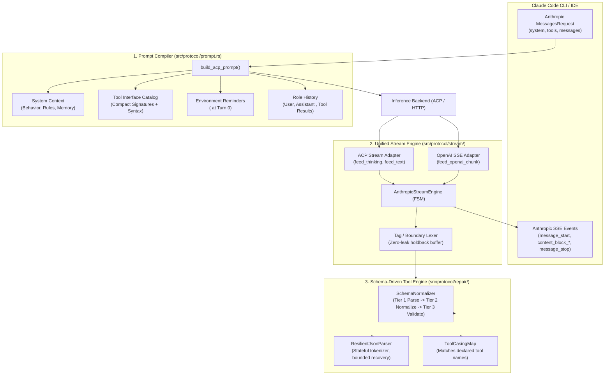
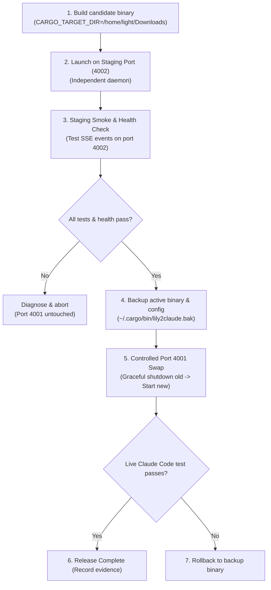

# Architecture Design: Unified State Machine & Schema-Driven Engine for Lily2Claude

- **Author:** Antigravity Engineering & User Pair Programming
- **Date:** 2026-10-20
- **Status:** Approved (Refined with Formal Transition & Contract Specifications)
- **Target Version:** lily2claude v0.2.0

---

## 1. Executive Summary & Problem Statement

### 1.1 Background
`lily2claude` acts as an Anthropic-compatible API bridge for Claude Code CLI and IDE extensions. It enables local and external LLMs (e.g. DeepSeek V4.1, GLM 5.3, Nemotron 3 Ultra) accessed via ACP (OpenCode, CommandCode) or OpenAI-compatible HTTP endpoints to power Claude Code.

### 1.2 Core Issues in Current Architecture
1. **Double System Prompt Wrapping & Semantic Conflict:**
   OpenCode ACP wraps its own system prompt ("You are OpenCode... Meta MSL") with Code Mode JS tools (`execute`, `search`), conflicting with Claude Code's system prompt and tool definitions.
2. **Fragmented Heuristic Parsing ("Parse linh tinh"):**
   The current repair layer (`src/protocol/repair/`) consists of 6 ad-hoc modules (`casing.rs`, `cleaner.rs`, `extractor.rs`, `json_args.rs`, `normalization.rs`, `validation.rs`) using disconnected regexes and heuristics.
3. **Divergent Streaming Implementations:**
   `AnthropicBlockStreamer` (for ACP output) and `SseStreamTranslator` (for OpenAI HTTP chunks) maintain separate, duplicate state machines with divergent bug fixes and token pacing logic.
4. **Context Ledger Token Inaccuracy:**
   Streaming delta events previously duplicated `input_tokens`, causing Claude Code's `/context` display to show inflated token counts (e.g. 577.1k/160k tokens).

### 1.3 Design Goal
Re-architect `lily2claude` into a **Unified, Cohesive Architecture** ("một thể thống nhất") modeled after Claude Code's native architecture:
- Cleanly compile prompts following Claude Code's separation of concerns (System Context vs Tool Interface vs Environment Reminders vs Turn Dialogue).
- Unify streaming and parsing into a single **Deterministic Finite State Machine (FSM)**.
- Replace ad-hoc heuristic regexes with a **Schema-Driven Normalizer** that validates arguments directly against Claude Code's declared tool schemas.

---

## 2. Architecture Overview



---

## 3. Detailed Component Specifications

### 3.1 Prompt Compiler (`src/protocol/prompt.rs`)
The prompt compiler transforms an Anthropic `MessagesRequest` into an upstream prompt that maximizes instruction adherence while minimizing token usage.

#### 3.1.1 Structure & Ordering:
1. **System Context:**
   - Preserves Claude Code's native developer instructions (`# System`, `# Doing tasks`, `# Executing actions with care`, `# Tone and style`, `# auto memory`).
   - Excludes raw JSON Schema dumps from the system string to conserve context window.
2. **Tool Interface Catalog (omitted during compaction):**
   - Declares tools using compact parameter signatures:
     ```text
     [Tools Instruction]
     To invoke a tool, output:
     <tool_call>
     {"name": "<tool_name>", "arguments": {<args>}}
     </tool_call>

     Available tools:
     - Bash(command, run_in_background?, timeout?)
     - Edit(file_path, new_string, old_string, replace_all?)
     - Read(file_path, limit?, offset?)
     - Write(content, file_path)
     - Agent(description, prompt, subagent_type?)
     ...
     ```
   - Appends an authoritative directive:
     `All tools are executed directly by the Claude Code harness. Never inspect local function catalogs.`
3. **Environment & Context Reminders:**
   - Preserves `<system-reminder>` blocks (working directory, platform, shell, OS, git status) within user turns, matching Claude Code's native turn structure.
4. **Dialogue Turns:**
   - Formats `User:`, `Assistant:`, and `Tool Result:` cleanly.
   - Serializes previous assistant tool calls as `<tool_call>` and tool results as `<tool_result>` (with `error=true` if applicable).
5. **Compaction Mode:**
   - When `req.is_compaction_request()` is true:
     - Strips tool declarations completely.
     - Injects `[COMPACTION DIRECTIVE]` requesting only `<summary>...</summary>`.

#### 3.1.2 Data Preservation Invariants:
- **No Rewriting:** System/developer instructions are never rewritten or omitted outside of the defined compaction policy.
- **Role Isolation:** Messages with different roles (`user`, `assistant`, `system`) are never merged into an ambiguous blob.
- **Multimodal Content:** Image content blocks emit `[Image attached]` placeholder or base64 structure without corrupting surrounding text.
- **Schema Safety:** Duplicate tool names are deduplicated; tools with missing/empty schemas default to parameterless signatures.

---

### 3.2 Internal Data Contracts & Type Definitions

```rust
/// Unified input stream event fed into AnthropicStreamEngine from adapters
#[derive(Debug, Clone)]
pub enum StreamInput {
    ThinkingDelta(String),
    TextDelta(String),
    UsageUpdate(crate::protocol::tokens::TokenUsage),
    Finish(FinishReason),
    UpstreamError(StreamError),
    Cancel,
}

#[derive(Debug, Clone, PartialEq, Eq)]
pub enum FinishReason {
    EndTurn,
    ToolUse,
    MaxTokens,
    StopSequence,
    Cancelled,
}

#[derive(Debug, Clone, PartialEq, Eq)]
pub enum StreamError {
    UpstreamDisconnected(String),
    RateLimitExceeded(String),
    ProtocolViolation(String),
    Internal(String),
}

/// Structured representation of a parsed tool call candidate before emission
#[derive(Debug, Clone, PartialEq)]
pub struct ToolCallCandidate {
    pub call_id: String,
    pub raw_name: String,
    pub mapped_name: String,
    pub raw_arguments: String,
    pub parsed_arguments: serde_json::Value,
    pub recovery_strategy: Option<String>,
}

/// Finite state machine states for the stream engine
#[derive(Debug, Clone, PartialEq, Eq)]
pub enum EngineState {
    Idle,
    Thinking,
    Text,
    ToolTagScan,
    ToolArguments,
    Finished,
}
```

---

### 3.3 State Transition Table (FSM Contract)

The engine transitions deterministically on each `StreamInput`. All events emitted are valid Anthropic SSE events.

| Current State | Event | Next State | Action / Invariant | Emitted SSE Events |
|---|---|---|---|---|
| `Idle` | `ThinkingDelta(s)` | `Thinking` | Open thinking block (index 0). | `content_block_start(type="thinking")`, `content_block_delta(thinking_delta=s)` |
| `Idle` | `TextDelta(s)` | `Text` | Open text block (index 0). Check holdback buffer. | `content_block_start(type="text")`, `content_block_delta(text_delta=safe_prefix)` |
| `Thinking` | `ThinkingDelta(s)` | `Thinking` | Append thinking chunk. If size exceeds 16KB, segment cleanly. | `content_block_delta(thinking_delta=s)` |
| `Thinking` | `TextDelta(s)` | `Text` | Close thinking block with signature. Open text block. | `content_block_delta(signature_delta="EqQ..."), content_block_stop`, `content_block_start(type="text")`, `content_block_delta` |
| `Text` | `TextDelta(s)` | `Text` (or `ToolTagScan`) | Check buffer for tool tag (`<tool_call>` or `<invoke>`). Hold back partial tag prefix. | `content_block_delta(text_delta=safe_prefix)` |
| `Text` | `<tool_call>` detected | `ToolTagScan` | Close text block. Flush safe pre-tag text. | `content_block_delta(pre_text)`, `content_block_stop` |
| `ToolTagScan` | Valid tag opening | `ToolArguments` | Allocate next block index. Generate tool call ID `call_acp_{ts}_{count}`. | (None until tool is validated or streamed) |
| `ToolArguments` | `TextDelta(s)` | `ToolArguments` | Buffer raw arguments until `</tool_call>` or `</invoke>` tag is seen. | (Internal buffering) |
| `ToolArguments` | Closing tag detected | `Text` (or `ToolTagScan`) | Run 3-Tier Normalization & Validation. Emit tool block. | `content_block_start(type="tool_use", id, name, input={})`, `content_block_delta(input_json_delta=arguments_json)`, `content_block_stop` |
| `ToolArguments` | Stream EOF / `Finish` before closing tag | `Finished` | Attempt bounded JSON recovery. If recoverable, emit `tool_use`. If unrecoverable, emit raw text without crashing. | `content_block_start(tool_use)`, `content_block_delta`, `content_block_stop` OR `content_block_delta(text)` |
| Any | `Cancel` | `Finished` | Close any open block immediately. | `content_block_stop` (if block open), `message_delta(stop_reason="cancelled")`, `message_stop` |
| Any | `UpstreamError(e)` | `Finished` | Close open block. Emit Anthropic error event. | `error(type="upstream_error", message=e)` |
| Any | `Finish(reason)` | `Finished` | Flush holdback buffer. Close open block. Emit usage & message_stop. | `content_block_stop` (if block open), `message_delta(stop_reason=reason, output_tokens=N)`, `message_stop` |

#### Chunk Invariance Property (Mandatory Invariant):
> For any byte stream `S`, regardless of how `S` is partitioned into chunks `[c_1, c_2, ...]` (e.g. 1 byte per chunk, split mid-tag, or single full chunk), the sequence of emitted Anthropic SSE events must be identical.

---

### 3.4 Wire Protocol & SSE Event Contract

| Event | Frequency | Constraints & Invariants |
|---|---|---|
| `message_start` | Exactly once | Sent on stream initialization. Usage contains `input_tokens` and `cache_read_input_tokens`. Output tokens initialized to 1. |
| `content_block_start` | 1 per block | Block index increments monotonically (0, 1, 2...). Type is strictly `"text"`, `"thinking"`, or `"tool_use"`. |
| `content_block_delta` | 1 or more per block | Delta type strictly matches block type (`text_delta`, `thinking_delta`, `signature_delta`, `input_json_delta`). |
| `content_block_stop` | Exactly once per block | Closes the current open block index before another block is started. |
| `message_delta` | Exactly once | Emitted at completion. Contains `stop_reason` (`end_turn`, `tool_use`, `max_tokens`) and delta `output_tokens`. NEVER re-sends `input_tokens`. |
| `message_stop` | Exactly once | Closes the message stream. |

---

### 3.5 Schema Normalization & JSON Recovery Policy

To prevent arbitrary data corruption, tool normalization operates strictly in three distinct tiers:

```
[Raw Tool Text] 
      │
      ▼
Tier 1: Parse (Strict JSON parser with bounded recovery)
      │ ──> Failure: Structured ParseError
      ▼
Tier 2: Normalize (Explicit Alias Registry, non-destructive)
      │ ──> Conflict: Structured AmbiguityError
      ▼
Tier 3: Validate (Claude Code JSON Schema validation)
      │ ──> Missing required: ValidationPolicyViolation
      ▼
[Emitted tool_use SSE Event]
```

#### Tier 1: Resilient JSON Parser (`repair/json_parser.rs`)
- **Strict-First:** Evaluates standard `serde_json::from_str`.
- **Bounded Recovery Rules:**
  - Unclosed string/object: Appends missing closing quote `"` and closing braces `}` up to max nesting depth 16.
  - Trailing commas: Strips trailing `,` before `}` or `]`.
  - Unescaped control characters: Replaces literal unescaped newlines (`\n`) and tabs (`\t`) inside string values with `\n` and `\t`.
  - Single quotes: Stateful scanner only replaces `'` with `"` when used as key or string delimiters, without corrupting inner single quotes in shell commands (e.g. `echo 'hello'`).
- **Safety Limits:** Input size limit 1MB, recursion limit 16.
- **Result:** `ParseResult::Valid(Value)`, `ParseResult::Recovered(Value, strategy)`, or `ParseResult::Invalid(ParseError)`.

#### Tier 2: Schema-Driven Normalizer (`repair/schema_normalizer.rs`)
- Inspects the tool's declared JSON Schema from `req.tools`.
- Resolves known non-ambiguous parameter aliases ONLY when the declared property exists:
  - `cmd` -> `command` (if schema requires `command` and has no `cmd`)
  - `file` -> `file_path` (if schema requires `file_path` and has no `file`)
  - `dir` -> `path` (if schema requires `path` and has no `dir`)
- **Conflict Rule:** If both keys exist (e.g. input has both `cmd` and `command`), normalization fails with `AmbiguityError`. Never overwrite existing keys.

#### Tier 3: Schema Validation (`repair/validation.rs`)
- Validates:
  1. Tool name exists in Claude Code's registered tool catalog (case-insensitive resolution).
  2. All `required` schema fields are present and non-empty.
  3. Primitive types match (`string`, `boolean`, `integer`).
- Any unvalidated tool call is rejected and logged; it is NEVER emitted to Claude Code as a valid `tool_use`.

---

## 4. Module Directory Structure

```
src/protocol/
├── mod.rs                        # Re-exports and protocol contracts
├── prompt.rs                     # Clean Claude Code prompt compiler
├── tool_engine/                  # Schema-Driven Tool Engine
│   ├── mod.rs                    # ToolCallEngine public facade
│   ├── json_parser.rs            # Resilient JSON tokenizer & parser
│   ├── schema_normalizer.rs      # Schema-driven argument normalizer
│   └── tag_lexer.rs              # Tag scanner (<tool_call>, <invoke>)
└── stream/                       # Unified Streaming Engine
    ├── mod.rs                    # Re-exports & stream test suite
    ├── events.rs                 # Anthropic SSE Event definitions
    ├── engine.rs                 # AnthropicStreamEngine (Core FSM)
    ├── acp_adapter.rs            # Adapter for ACP chunk streams
    └── openai_adapter.rs         # Adapter for OpenAI SSE streams
```

---

## 5. Migration, Staging & Rollback Strategy



### Safety & Operational Guarantees:
- Active production daemon on port 4001 is NEVER touched until candidate binary passes all tests on port 4002.
- Backup binary is preserved at `/home/light/.cargo/bin/lily2claude.bak`.
- If health check or smoke test fails, port 4001 continues running uninterrupted.

---

## 6. Definition of Done (19-Point Verification Checklist)

### Protocol & Stream Lifecycle:
- [ ] 1. Every block (`thinking`, `text`, `tool_use`) is opened and closed exactly once in normal completion.
- [ ] 2. Zero leakage of internal tags (`<tool_call>`, `<invoke>`, `EqQ...`) into user-visible text.
- [ ] 3. **Chunk Invariance:** Identical SSE event sequence produced regardless of chunk fragmentation.
- [ ] 4. Resiliently handles EOF, unclosed tags, cancellation, and upstream errors without hanging or panic.
- [ ] 5. Multi-block transitions (`thinking -> text -> tool_call -> text`) function seamlessly in a single turn.

### Tool Engine & Normalization:
- [ ] 6. Tool name verified and matched case-insensitively against Claude Code's declared tools catalog.
- [ ] 7. Valid JSON arguments are preserved without modification outside declared normalization rules.
- [ ] 8. Alias conflicts, missing required arguments, and type mismatches return structured errors.
- [ ] 9. JSON recovery covers unclosed braces, escaped characters, single quotes, and logs recovery strategy.
- [ ] 10. Unvalidated or malformed tool calls are NEVER emitted as valid `tool_use`.

### Prompt Compiler:
- [ ] 11. Role labels, message order, and tool result linkage are strictly preserved.
- [ ] 12. Historical tool calls and tool results serialize and deserialize deterministically.
- [ ] 13. Compaction mode eliminates tool catalog without corrupting context necessary for summarization.
- [ ] 14. Multimodal blocks (images/documents) are preserved cleanly.

### Operations & Release Verification:
- [ ] 15. All 83 existing tests (49 unit + 34 integration) pass with zero regressions.
- [ ] 16. New unit tests added for FSM transitions, resilient JSON parsing, and schema normalization.
- [ ] 17. Candidate binary verified on staging port 4002 before replacing port 4001 daemon.
- [ ] 18. Rollback procedure and backup binary verified.
- [ ] 19. Live Claude Code CLI verification: `Bash: pwd`, `Agent` subagent spawning, `CronCreate`, and `/context` ledger accuracy.
